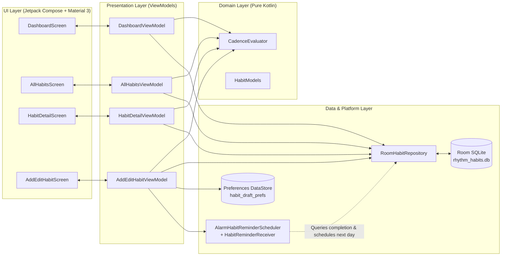

# Rhythm Habit Tracker — Documentation

**Rhythm** (`com.rhythm.habittracker`) is an offline-first, native Android habit tracker built with **Kotlin** and **Jetpack Compose**. Its interface and cadence engine implement the **Minimalist Habit Tracker ("Functional Habit Architecture")** design system from Google Stitch (`Project ID: 11168505724477891257`).

---

## Documentation Map

| Guide | Purpose |
| :--- | :--- |
| **[Architecture & Data Flow](./architecture.md)** | Layered architecture, manual dependency injection (`AppContainer`), Navigation 3 routing (`DashboardRoute`, `AllHabitsRoute`, `HabitDetailRoute`, `AddEditHabitRoute`), widget deep-linking (`EXTRA_OPEN_HABIT_ID`), and reactive `StateFlow` pipelines. |
| **[Domain & Cadence Engine](./domain-and-cadence-engine.md)** | Scheduling rules (`DAILY`, `WEEKLY`, `MONTHLY`, `CUSTOM` with configurable start date), single-occurrence rescheduling with conflict prevention, override sanitization (`sanitizeRescheduleOverrides` / `hasCadenceChanged`), multi-instance daily habits, flexible weekly pools, short-month rollbacks, current/best streak calculation (`calculateStreak` / `calculateBestStreak`), schedule formatting (`formatHabitScheduleSummary`), multi-week heatmap generation (32-week Dashboard matrix / 20-week Habit Detail matrix), and pure widget telemetry aggregation (`WidgetDataBuilder`). |
| **[Persistence & Reminders](./persistence-and-reminders.md)** | Room SQLite schema (`rhythm_habits.db`, v4 with per-instance completion tracking and rescheduled date overrides), atomic `@Transaction` reschedule/undo cleanup, serialized draft/edit autosave (`habit_draft_prefs`), persisted domains/preferences, per-widget SharedPreferences (`rhythm_widget_prefs` via `WidgetPreferencesStore`), reactive widget auto-refresh (`RhythmWidgetUpdater`), and `AlarmManager` notification delivery. |
| **[UI & Design System](./ui-and-design-system.md)** | Monochrome surface palette, 7 accent signatures, `Inter` + `JetBrains Mono` typography tokens, adaptive launcher icon matching `RhythmBrandMark`, expandable Dashboard navigation FAB (`Add Habit` / `All Habits`), due-time sorted Dashboard task lists with day-part progress bars placed below the weekday strip and day-part completion confetti + rainbow perimeter spin animation, All Habits Inventory (`AllHabitsScreen`), Habit Detail view (`HabitDetailScreen`), responsive Light/Dark Android Home Screen Widgets (`HabitCadenceWidgetProvider`, `OverallCadenceWidgetProvider`, `UpcomingTasksWidgetProvider`, `WidgetConfigActivity`, `WidgetBitmapRenderer`), cancelable swipe-to-reschedule modal + undo banner, domain deletion modal, cancelable checking color-wave animation, screen-by-screen Stitch mapping, and Compose `@Preview` rendering. |

---

## System Overview



---

## Tech Stack & Build Configuration

| Aspect | Value / Version | Source |
| :--- | :--- | :--- |
| **Application ID / Namespace** | `com.rhythm.habittracker` | [app/build.gradle.kts](../app/build.gradle.kts) |
| **SDK Levels** | `minSdk = 26`, `compileSdk = 36`, `targetSdk = 36` | [app/build.gradle.kts](../app/build.gradle.kts) |
| **Android Gradle Plugin (AGP)** | `9.0.1` (built-in Kotlin `2.3.20`, JDK 17 toolchain) | [gradle/libs.versions.toml](../gradle/libs.versions.toml) |
| **Jetpack Compose BOM** | `2026.03.01` (`material3`, `ui`, `material-icons-extended`) | [gradle/libs.versions.toml](../gradle/libs.versions.toml) |
| **Navigation** | AndroidX Navigation 3 (`1.0.1`) + `lifecycle-viewmodel-navigation3` (`2.10.0`) | [Navigation.kt](../app/src/main/kotlin/com/rhythm/habittracker/Navigation.kt) |
| **Database** | AndroidX Room (`2.8.5`) with KSP (`2.3.14`) | [HabitDatabase.kt](../app/src/main/kotlin/com/rhythm/habittracker/data/local/HabitDatabase.kt) |
| **Draft Storage** | AndroidX DataStore Preferences (`1.3.0`) + `kotlinx-serialization-json` (`1.13.0`) | [DraftHabitStore.kt](../app/src/main/kotlin/com/rhythm/habittracker/data/local/DraftHabitStore.kt) |

---

## Common Developer Commands

### 1. Build Debug APK & Run Unit Tests
```powershell
.\gradlew.bat assembleDebug testDebugUnitTest compileDebugAndroidTestKotlin
```
- **Output APK**: `app/build/outputs/apk/debug/app-debug.apk`
- **Unit Test Reports**: `app/build/test-results/testDebugUnitTest/*.xml`

### 2. List & Render Headless Compose Previews
Using the Android CLI (`android.exe`):
```powershell
# List all @Preview functions in :app
C:\Users\cursa\AppData\AndroidCLI\android.exe preview list "?:app"

# Render a specific @Preview to PNG without an emulator
C:\Users\cursa\AppData\AndroidCLI\android.exe preview render "?:app" `
  --output=build/previews `
  --fqn=com.rhythm.habittracker.ui.dashboard.DashboardScreenKt.DashboardScreenPreview
```

### 3. Install Over Wireless ADB
For an already-paired phone using Wireless Debugging (`_adb-tls-connect._tcp`), start the ADB server and wait ~4 seconds in the same command so mDNS discovers the device before installing:
```powershell
C:\Users\cursa\AppData\Local\Android\Sdk\platform-tools\adb.exe start-server; Start-Sleep -Seconds 4; C:\Users\cursa\AppData\Local\Android\Sdk\platform-tools\adb.exe -s adb-48201FDAS0004G-PnRogK._adb-tls-connect._tcp install -r app\build\outputs\apk\debug\app-debug.apk
```
If pairing a new device for the first time:
```powershell
C:\Users\cursa\AppData\Local\Android\Sdk\platform-tools\adb.exe pair <hostname-or-ip>:<pairing-port> <6-digit-code>
C:\Users\cursa\AppData\Local\Android\Sdk\platform-tools\adb.exe connect <device-ip>:<connect-port>
C:\Users\cursa\AppData\Local\Android\Sdk\platform-tools\adb.exe -s <device-ip>:<connect-port> install -r app\build\outputs\apk\debug\app-debug.apk
```
