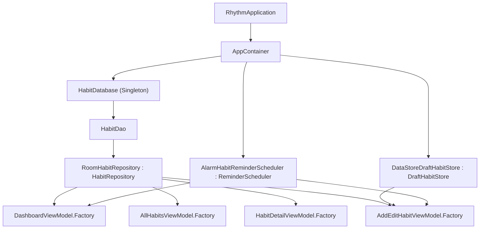
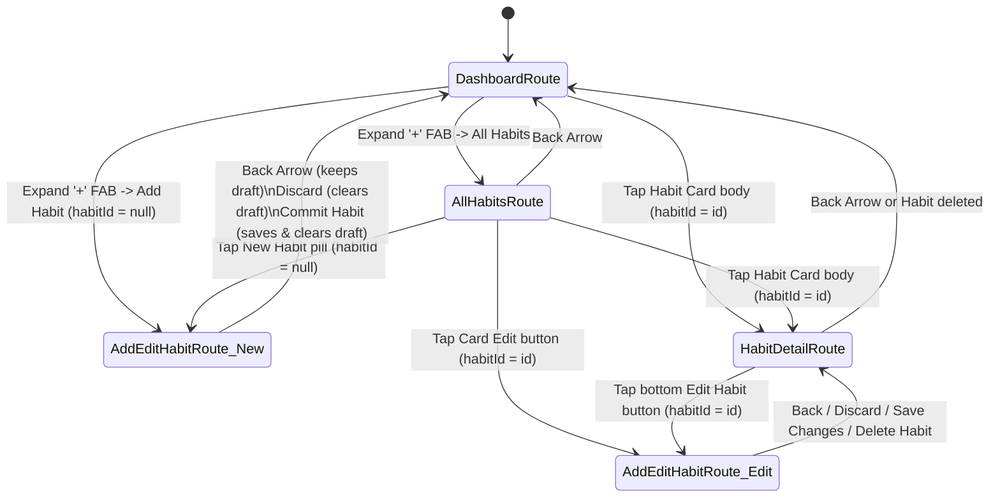
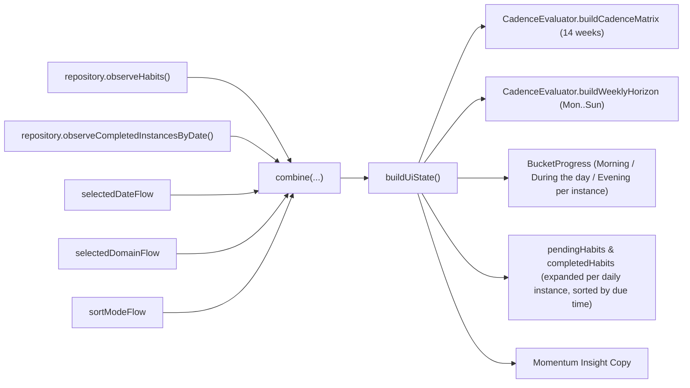
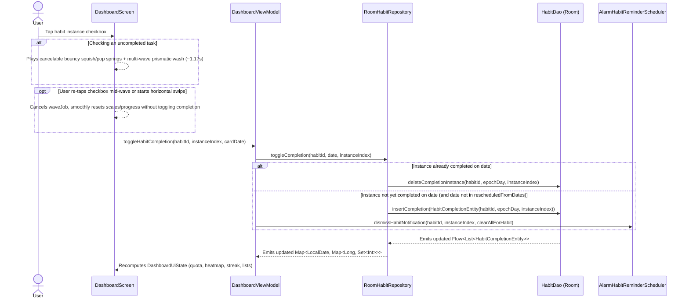
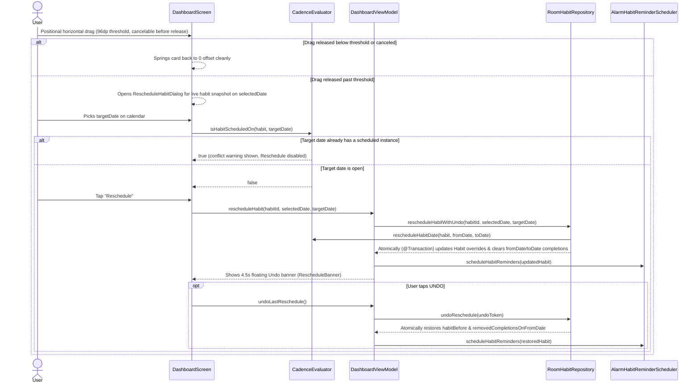
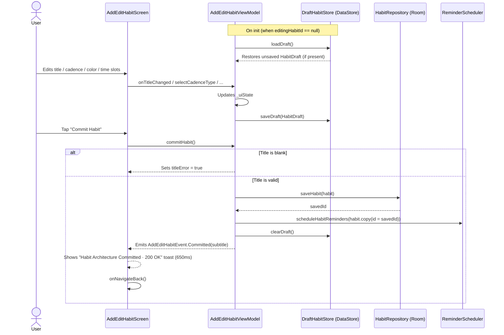

# System Architecture & Data Flow

Rhythm follows a unidirectional data flow (UDF) architecture organized into four clear packages under `com.rhythm.habittracker`:

1. **`ui/`** — Stateless Jetpack Compose screens (`DashboardScreenContent`, `AllHabitsScreenContent`, `HabitDetailScreenContent`, `AddEditHabitScreenContent`), stateful route wrappers, reusable tactile components (`RhythmComponents`), and the `RhythmTheme` design system.
2. **`ui/.../*ViewModel.kt`** — Screen-level state holders (`DashboardViewModel`, `AllHabitsViewModel`, `HabitDetailViewModel`, `AddEditHabitViewModel`) exposing immutable `StateFlow` UI state and one-shot `SharedFlow` events.
3. **`domain/`** — Pure Kotlin models (`Habit`, `CadenceType`, `TargetTimeSlot`) and the stateless `CadenceEvaluator` engine. Zero Android framework dependencies (uses `java.time.*`, available natively on `minSdk = 26`).
4. **`data/` & `reminders/`** — Offline persistence (`HabitDatabase`, `HabitDao`, `RoomHabitRepository`, `DataStoreDraftHabitStore`) and `AlarmManager` scheduling (`AlarmHabitReminderScheduler`, `HabitReminderReceiver`).

---

## Package & File Layout

```text
app/src/main/kotlin/com/rhythm/habittracker/
├── MainActivity.kt                  # Edge-to-edge ComponentActivity hosting RhythmTheme + MainNavigation & EXTRA_OPEN_HABIT_ID deep-links
├── Navigation.kt                    # Navigation 3 NavDisplay with ViewModel-scoped entryDecorators & deep-link LaunchedEffect
├── NavigationKeys.kt                # @Serializable NavKey routes (DashboardRoute, AllHabitsRoute, HabitDetailRoute, AddEditHabitRoute)
├── RhythmApplication.kt             # Application class, manual DI container (AppContainer), widget auto-refresh & completion notification auto-dismissal observer
├── data/
│   ├── HabitRepository.kt           # HabitRepository interface + Mutex-serialized RoomHabitRepository (incl. RescheduleOutcome/UndoToken)
│   └── local/
│       ├── DraftHabitStore.kt       # DataStore Preferences autosave for in-progress new habits
│       ├── HabitDatabase.kt         # RoomDatabase singleton (rhythm_habits.db, v4)
│       ├── HabitMapper.kt           # HabitEntity <-> Habit domain conversion (CSV & JSON)
│       ├── dao/HabitDao.kt          # Reactive Flow & suspend queries, CRUD, and atomic @Transaction reschedule/undo cleanup
│       └── entity/HabitEntity.kt    # HabitEntity, HabitCompletionEntity, CustomDomainEntity, DashboardPreferencesEntity
├── domain/
│   ├── CadenceEvaluator.kt          # Pure recurrence, rescheduling/sanitization, current/best streak, summary formatting, horizon & matrix math
│   └── model/HabitModels.kt         # Habit, HabitAccentColor, CadenceType, TargetTimeSlot, enums
├── reminders/
│   ├── HabitReminderReceiver.kt     # BroadcastReceiver firing notifications & rescheduling next day
│   └── HabitReminderScheduler.kt    # ReminderScheduler interface + AlarmManager implementation
├── widget/
│   ├── WidgetModels.kt              # WidgetKind, WidgetThemeMode, SingleHabitWidgetData, OverallMatrixWidgetData, UpcomingTasksWidgetData, WidgetTaskItem
│   ├── WidgetPreferencesStore.kt    # SharedPreferences store for per-widget Light/Dark mode & Single-Habit target ID
│   ├── WidgetDataBuilder.kt         # Pure Kotlin widget snapshot aggregator for all 3 home screen widgets
│   ├── WidgetBitmapRenderer.kt      # High-DPI responsive Canvas renderer (Light/Dark, Tall/Wide/Square sizes, relative matrix + unscheduled 'X')
│   ├── RhythmWidgetUpdater.kt       # AppWidgetManager RemoteViews updater + PendingIntent router (deep-links & task toggles)
│   ├── HabitCadenceWidgetProvider.kt    # AppWidgetProvider for single-habit cadence matrix widget
│   ├── OverallCadenceWidgetProvider.kt  # AppWidgetProvider for overall cadence & time-block matrix widget
│   ├── UpcomingTasksWidgetProvider.kt   # Interactive AppWidgetProvider supporting home screen task completion toggles (ACTION_TOGGLE_TASK)
│   ├── WidgetConfigActivity.kt      # Reconfigurable Compose settings screen (live size previews, Light/Dark switcher, habit picker)
│   └── WidgetPreviews.kt            # Compose @Preview gallery for tall/wide/square light/dark widgets
└── ui/
    ├── addhabit/
    │   ├── AddEditHabitScreen.kt    # New / Edit Habit Architect UI + Daily/Weekly/Monthly/Custom tabs + Domain delete confirm
    │   └── AddEditHabitViewModel.kt # Form state, serialized draft/edit autosave, cadence-change override cleanup, commit/delete
    ├── allhabits/
    │   ├── AllHabitsScreen.kt       # System Inventory list, telemetry bar, live search, domain chips & detail/edit navigation
    │   └── AllHabitsViewModel.kt    # Inventory stats, domain chip counts, search/domain filtering into AllHabitsUiState
    ├── components/
    │   └── RhythmComponents.kt      # RhythmBrandMark, RhythmProfileAvatar, RhythmTactileSwitch, RhythmConfettiOverlay, RhythmMatrixCell
    ├── dashboard/
    │   ├── DashboardScreen.kt       # Dashboard UI, expandable FAB nav (Add Habit / All Habits), heatmap, weekly strip, swipe-to-reschedule & wave
    │   └── DashboardViewModel.kt    # Combines DB flows + date/domain/sort filters + reschedule/undo state into DashboardUiState
    ├── habitdetail/
    │   ├── HabitDetailScreen.kt     # Read-only habit analytics, 20-week completion matrix, target schedule, 7-day run & Edit Habit CTA
    │   └── HabitDetailViewModel.kt  # Computes current/best streak, overall rate, 20-week heatmap, skips & weekly strip into HabitDetailUiState
    └── theme/
        ├── Color.kt                 # Calibrated monochrome surface spectrum + emerald heatmap color
        ├── Theme.kt                 # RhythmTheme & CompositionLocal typography provider
        └── Type.kt                  # Bundled Inter + JetBrains Mono (tnum) token definitions
```

---

## Dependency Injection (`AppContainer`)

To keep build times fast and avoid annotation-processing overhead beyond Room, dependencies are wired manually in [`RhythmApplication.kt`](../app/src/main/kotlin/com/rhythm/habittracker/RhythmApplication.kt):



All collaborators (`HabitRepository`, `DraftHabitStore`, `ReminderScheduler`) are defined as interfaces so unit tests (`DashboardViewModelTest`, `AllHabitsViewModelTest`, `HabitDetailViewModelTest`, `AddEditHabitViewModelTest`) can inject fast in-memory fakes without requiring Android instrumentation.

---

## Navigation 3 Graph & Scoping

[`Navigation.kt`](../app/src/main/kotlin/com/rhythm/habittracker/Navigation.kt) uses AndroidX **Navigation 3** (`NavDisplay` + `rememberNavBackStack(DashboardRoute)`) with two entry decorators:
- `rememberSaveableStateHolderNavEntryDecorator()` — preserves Compose `rememberSaveable` state across backstack transitions.
- `rememberViewModelStoreNavEntryDecorator()` — scopes `ViewModel` instances to individual backstack entries so popping `AddEditHabitRoute` clears its `AddEditHabitViewModel`.



`AddEditHabitRoute` carries `val habitId: Long? = null` and `val instanceId: Long = 0L`, which is used as part of the `viewModel(key = "add_edit_${route.habitId ?: "new"}_${route.instanceId}")` key to guarantee a fresh `AddEditHabitViewModel` on every navigation, and `HabitDetailRoute(habitId)` scopes its `HabitDetailViewModel` via `key = "habit_detail_${route.habitId}"`.

---

## Reactive Data Flows

### 1. Dashboard State Aggregation

`DashboardViewModel` combines five reactive streams into a single `StateFlow<DashboardUiState>`:



When a user taps a habit instance's checkbox on the Dashboard:



When a user drags a `HabitCard` on the Dashboard to reschedule it:



### 2. New Habit Draft Autosave & Commit Flow

When creating a new habit (`editingHabitId == null`), field edits are serialized via `draftSaveJob` and persisted asynchronously to `DraftHabitStore` (`DataStore<Preferences>`), powering the `DRAFT AUTOSAVED` status badge (while editing an existing habit serializes Room writes through `autosaveJob`, gated on `isInitialLoadComplete`):


