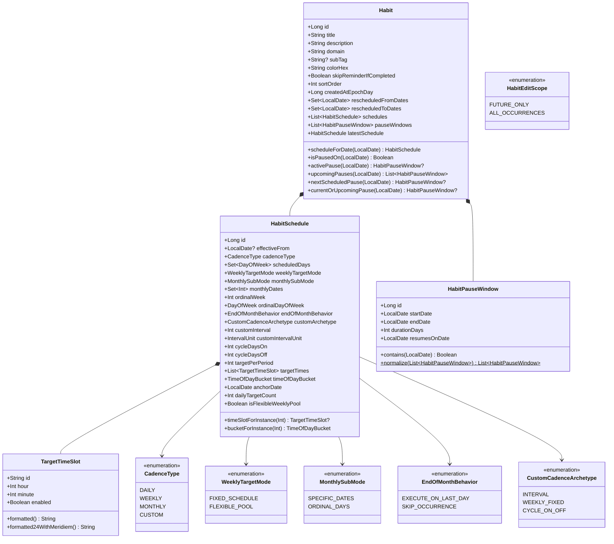
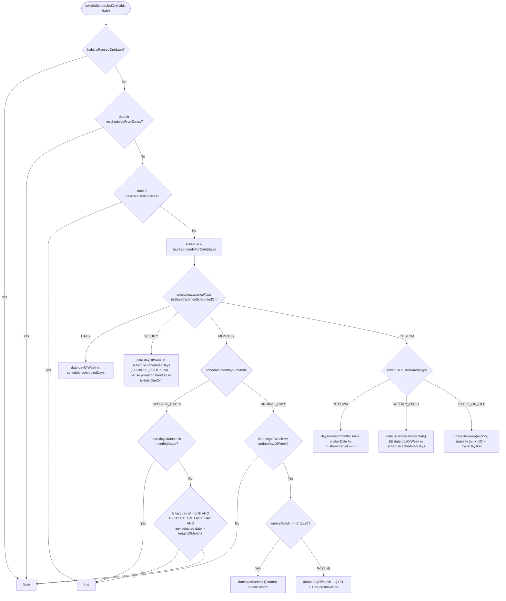

# Domain Model & Cadence Engine

All habit scheduling, streak evaluation, weekly horizon dots, and multi-week consistency matrix calculations live in [`domain/CadenceEvaluator.kt`](../app/src/main/kotlin/com/rhythm/habittracker/domain/CadenceEvaluator.kt) and [`domain/model/HabitModels.kt`](../app/src/main/kotlin/com/rhythm/habittracker/domain/model/HabitModels.kt).

---

## Domain Model Class Diagram

---

## Effective-Dated Scheduling & Pause Rules (`isHabitScheduledOn`, `isHabitDueOn` & `rescheduleHabitDate`)

Every `Habit` holds a chronological list of `HabitSchedule` versions (`effectiveFrom == null` for the initial baseline stored at `HabitSchedule.BASELINE_EPOCH_DAY = Long.MIN_VALUE`, plus optional dated versions sorted by `HabitSchedule.CHRONOLOGICAL_ORDER`) and normalized `HabitPauseWindow` date ranges. For any calendar date `date`, `habit.scheduleForDate(date)` resolves the active `HabitSchedule` version, while `habit.latestSchedule` returns the newest scheduled rule (e.g. for "starts tomorrow" edits).

`CadenceEvaluator` distinguishes between calendar scheduling, daily due visibility, schedule edits, pause suspension, and single-occurrence reschedules:
1. **`isHabitScheduledOn(habit, date)`** — Is `date` an active scheduled calendar day for `habit`?
   - Returns `false` immediately if `habit.isPausedOn(date)` is `true` or `date in habit.rescheduledFromDates`.
   - Returns `true` if `date in habit.rescheduledToDates`.
   - Otherwise resolves `val schedule = habit.scheduleForDate(date)` and delegates to `isBaseCadenceScheduledOn(schedule, date)`. Note that for `CadenceType.WEEKLY` with `WeeklyTargetMode.FLEXIBLE_POOL`, `isBaseCadenceScheduledOn` evaluates `date.dayOfWeek in schedule.scheduledDays` so conflict checks in `RescheduleHabitDialog` do not block every calendar day.
2. **`isHabitDueOn(habit, date, completedDates)`** — Should `habit` appear on the Dashboard / reminders for `date`?
   - If `date in habit.rescheduledFromDates`, returns `false` first (even if stray completions existed prior to sanitization).
   - If `date in completedDates`, returns `true` (so already-completed occurrences on a date remain visible even if a pause begins the same day).
   - If `habit.isPausedOn(date)`, returns `false`.
   - If `date in habit.rescheduledToDates`, returns `true`.
   - If `habit.scheduleForDate(date).isFlexibleWeeklyPool`, checks completions logged in that ISO `Mon–Sun` week against **`flexiblePoolDueTargetForWeek(habit, weekStart, date)`**, which uses `scheduleForDate(date).scheduledDays.size` and prorates proportionally across unpaused days in partially paused weeks: `round(baseTarget * activeDays / 7.0).coerceIn(1, min(baseTarget, activeDays))` (or `0` when all 7 days are paused). Remaining unpaused days of a mid-week edit week immediately use the new active schedule's target.
   - Otherwise, delegates to `isBaseCadenceScheduledOn(schedule, date)`.
3. **Effective-Dated Schedule Edits (`applyScheduleEdit`, `applyIdentityAndReminderOnlyEdit`, `hasCadenceChanged`, `hasScheduleOrTimesChanged`)**:
   - `hasScheduleOrTimesChanged(old, new)` detects changes to cadence rules, `dailyTargetCount`, or target `(hour, minute)` pairs (ignoring reminder-only toggles `slot.enabled` and `skipReminderIfCompleted`).
   - Identity & reminder-only changes run `applyIdentityAndReminderOnlyEdit(...)`, updating identity fields habit-wide and syncing `enabled` flags onto both the latest schedule and an active today schedule when an edit starting tomorrow exists, without splitting schedules or disturbing reschedule overrides.
   - Schedule/time changes prompt the user (`SaveScopeDialog`) with a smart cutoff (`today` if zero completions are logged today, else `today.plusDays(1)`):
     - **`HabitEditScope.ALL_OCCURRENCES`**: collapses history to a single baseline schedule (`effectiveFrom = null`) and clears reschedule overrides if cadence changed.
     - **`HabitEditScope.FUTURE_ONLY`**: preserves all schedules strictly before `effectiveFrom` (`effectiveFrom == null || it.effectiveFrom.isBefore(effectiveFrom)`), appends (or coalesces if unchanged relative to predecessor) a new version with `effectiveFrom = cutoff`, and preserves past `< effectiveFrom` reschedule overrides while clearing `>= effectiveFrom` overrides if cadence changed at cutoff.
   - Switching an existing non-`CUSTOM` habit into `CadenceType.CUSTOM` defaults `anchorDate` to `today` (unless already picked by the user), matching the 30-day projection preview.
4. **Pixel-Clock Pause Windows (`addOrUpdatePauseWindow`, `resumeOrCancelPause`)**:
   - `HabitPauseWindow.normalize` validates `endDate >= startDate` and merges overlapping or adjacent (`startDate <= last.endDate.plusDays(1)`) ranges.
   - `addOrUpdatePauseWindow` inserts or edits `[startDate, endDate]` and re-normalizes. Occurrences inside the pause range are skipped while Custom Interval / On-Off Cycle habits keep their `anchorDate` calendar rhythm after `resumesOnDate = endDate.plusDays(1)`.
   - `resumeOrCancelPause(existing, today)`: if an active pause covers `today` with `startDate < today`, truncates `endDate = today.minusDays(1)` so past paused days remain protected; if `startDate == today`, deletes that pause window; otherwise cancels the next upcoming scheduled pause (`startDate > today`).
5. **`sanitizeRescheduleOverrides(habit)` & `rescheduleHabitDate(habit, fromDate, toDate)`**:
   - `sanitizeRescheduleOverrides` evaluates each `from`/`to` date against `scheduleForDate(date)` (retaining moved flexible-pool days, pruning out-of-cadence `from` dates and base-covered `to` dates, and eliminating `from`/`to` overlap).
   - `rescheduleHabitDate` rejects shifts (returns `null`) when `fromDate == toDate`, either date is paused (`isPausedOn`), `fromDate` is not eligible, or `isHabitScheduledOn(sanitized, toDate)` is already `true`.

---

## Supported Cadence Modes in Detail

### 1. Daily (`CadenceType.DAILY`)
- Defaults to all 7 days (`Mon–Sun`), or any subset toggled in the 7-day strip.
- Evaluates `date.dayOfWeek in habit.scheduledDays`.

### 2. Weekly (`CadenceType.WEEKLY`)
- **Quick Presets** (`WeeklyPreset`):
  - `WEEKDAYS`: `Mon–Fri` (5x/week)
  - `WEEKENDS`: `Sat–Sun` (2x/week)
  - `EVERY_OTHER_DAY`: `Mon, Wed, Fri` (3x/week)
  - `ALL`: `Mon–Sun` (7x/week)
- **Allocation Logic** (`WeeklyTargetMode`):
  - `FIXED_SCHEDULE` (*"Target per selected day"*): Habit only appears on the selected weekdays.
  - `FLEXIBLE_POOL` (*"Flexible weekly pool"*): The number of selected days defines the weekly target $N = \max(1, |\text{scheduledDays}|)$. The habit can be completed on any day between Monday and Sunday until $N$ completions are logged in that ISO week.

### 3. Monthly (`CadenceType.MONTHLY`)
- **Specific Dates (`MonthlySubMode.SPECIFIC_DATES`)**:
  - Any combination of days `1..31` selected in the 7-column Monthly Calendar Matrix or via `MonthlyDatePreset` (`1st of month`, `1st & 15th`, `Last day of month`, `Quarter start`).
  - **End-of-Month Short Dates (`EndOfMonthBehavior`)**:
    - `EXECUTE_ON_LAST_DAY`: In months with fewer than 31 days (e.g., Feb 28/29 or Apr 30), any selected date greater than `date.lengthOfMonth()` automatically rolls back and fires on the final day of that month.
    - `SKIP_OCCURRENCE`: Dates greater than `date.lengthOfMonth()` are skipped for that month.
- **Ordinal Days (`MonthlySubMode.ORDINAL_DAYS`)**:
  - Fires on the $k$-th weekday of each month (`ordinalWeek` $\in \{1, 2, 3, 4, -1\}$ where $-1$ means *Last*, paired with `ordinalDayOfWeek`).

### 4. Custom (`CadenceType.CUSTOM`)
All three custom cadence archetypes honor a user-selectable **Start Date** (`habit.anchorDate`, configurable via the Material 3 `DatePickerDialog` in `CustomCadenceBody`, defaulting to today):
- **Interval (`CustomCadenceArchetype.INTERVAL`)**:
  - Repeats every $N$ `DAYS`, `WEEKS`, or `MONTHS` anchored at `habit.anchorDate` (unscheduled before `anchorDate`).
- **Weekly Fixed (`CustomCadenceArchetype.WEEKLY_FIXED`)**:
  - Custom weekday mask with a configurable `targetPerPeriod`, active on or after `habit.anchorDate`.
- **Work Sprint / Recovery Cycle (`CustomCadenceArchetype.CYCLE_ON_OFF`)**:
  - Alternates `cycleDaysOn` active days followed by `cycleDaysOff` recovery days starting from `habit.anchorDate`.

### 5. Multi-Instance Daily Habits (`dailyTargetCount` & `targetTimes`)
- On any date `date`, `val schedule = habit.scheduleForDate(date)` expands into `schedule.dailyTargetCount = max(schedule.targetTimes.size, schedule.targetPerPeriod).coerceAtLeast(1)` individual cards on the Dashboard (`instanceIndex` in `0 until dailyTargetCount`).
- Each instance is associated with its corresponding `TargetTimeSlot` (`schedule.timeSlotForInstance(instanceIndex)`) and time-of-day bucket (`schedule.bucketForInstance(instanceIndex)`), allowing each instance to be checked off independently (e.g., `1/2 · 08:00 AM` and `2/2 · 08:00 PM`) and counted in its own `TimeOfDayBucket` (`MORNING`, `DURING_THE_DAY`, `EVENING`).
- A habit is considered fully completed on `date` for streak calculation once `completedInstances >= habit.scheduleForDate(date).dailyTargetCount`.

---

## Streak Calculation (`calculateStreak`, `calculateBestStreak`) & Schedule Summary

`calculateStreak` and `calculateBestStreak` use a unified **ISO-week maximal-run** engine (`partitionWeekRuns` + `flexRunPasses`) so habits that transition mid-history between fixed cadences and `FLEXIBLE_POOL`, or experience pause windows, retain continuous accurate streaks:

- **Partitioning (`partitionWeekRuns`)**: Each `Mon–Sun` week (up to `referenceDate` / historical horizon) is partitioned into maximal contiguous runs sharing `scheduleForDate(cursor).isFlexibleWeeklyPool`.
- **Fixed Runs (`!run.isFlex`)**:
  - Completed dates (`cursor in completedDates`) increment the streak (even on paused/unscheduled days); uncompleted dates break the streak only when `isHabitScheduledOn(habit, cursor)` is `true` (which is already `false` when `habit.isPausedOn(cursor)`), preserving streaks cleanly across pauses and unscheduled rest days.
  - Today (`cursor == referenceDate`) is excused while uncompleted so an active streak from yesterday stays visible until the day ends.
- **Flexible Weekly Pool Runs (`run.isFlex`, `flexRunPasses`)**:
  - Sums `runCompletions` across the run's days. If every day in the run is paused (`unpausedRunDays.isEmpty()`), the run is excused and passes without resetting the streak.
  - For active runs, computes the forgiving minimum target across `unpausedRunDays` (`minFlexTarget`), prorated (`floor((minFlexTarget * unpausedRunDays.size) / 7.0)`) on partial/mid-week transition or paused weeks, and also passes if the full week's completions meet `weekRequired`. The trailing current week ending on `referenceDate` remains protected while in progress.
- **Historical Best Streak (`calculateBestStreak`)**: Scans up to 1,095 days forward across partitioned ISO weeks and returns `maxOf(best, currentStreak)`.
- **Schedule Summary (`formatHabitScheduleSummary`)**: Produces uppercase Stitch telemetry strings from `habit.latestSchedule` (or a given `HabitSchedule`) combining cadence type, selected weekdays/dates/interval, and earliest `TargetTimeSlot` cue.

---

## Cadence Matrix (`buildCadenceMatrix`)

Generates a configurable `weeks`-column $\times$ 7-row (32 weeks / 224 days on Dashboard for past-only horizontal scrolling, 20 weeks / 140 days on Habit Detail) grid aligned to Monday-through-Sunday columns ending on the current week:

- For each date $d$ (future and past/present):
  - Evaluates `allPaused = habits.isNotEmpty() && habits.all { it.isPausedOn(d) }`.
  - Computes `scheduledHabits = habits.filter { isHabitScheduledOn(it, d) }` and `scheduledCount = scheduledHabits.sumOf { it.scheduleForDate(d).dailyTargetCount }`.
  - Records `completedCount` scoped to `habitIds = habits.mapTo(mutableSetOf()) { it.id }` (counting capped scheduled instance completions when scheduled, or off-schedule completions for `habitIds` when `scheduledCount == 0`).
  - Exposes `completionRatio = completedCount / scheduledCount` clamped to `[0f, 1f]` (or `1f` if an unscheduled past/today cell has an off-schedule completion, `0f` for future or uncompleted days).
  - Exposes `isPaused` and two mutually exclusive empty markers:
    - `isPausedEmpty = isPaused && !isScheduled && (isFuture || completedCount <= 0)` so UI matrix cells render subtle **`||` pause bars** on paused days.
    - `isUnscheduledEmpty = !isPausedEmpty && !isScheduled && (isFuture || completedCount <= 0)` so non-paused rest days render a symmetric grey `X` (differentiating rest days and paused days from missed scheduled tasks, which remain plain grey).
  - Maps $r = \text{completionRatio}$ to `MatrixIntensity`:
    - `NONE`: $r \le 0$
    - `LOW`: $0 < r < 0.5$
    - `MEDIUM`: $0.5 \le r < 1$
    - `HIGH`: $r \ge 1$ (only when all scheduled tasks for the day are completed)
- Aggregates overall consistency percentage across all scheduled days in the window:
  $$\text{consistencyPercent} = \text{round}\left(\frac{\sum \text{completedScheduled}}{\sum \text{totalScheduled}} \times 100\right)$$

---

## Widget Telemetry Aggregation (`WidgetDataBuilder`)

[`WidgetDataBuilder.kt`](../app/src/main/kotlin/com/rhythm/habittracker/widget/WidgetDataBuilder.kt) reuses `CadenceEvaluator` rules to produce immutable, date-scoped, pure-Kotlin snapshots for all three home screen widgets (`SingleHabitWidgetData`, `OverallMatrixWidgetData`, `UpcomingTasksWidgetData`), ensuring multi-instance habits (`habit.scheduleForDate(today).dailyTargetCount`), effective-dated schedule transitions, paused status & `||` pause bars, reschedule overrides, task-relative heatmap intensity, unscheduled rest-day `X` markers, and time-of-day buckets match the main application 1:1.
