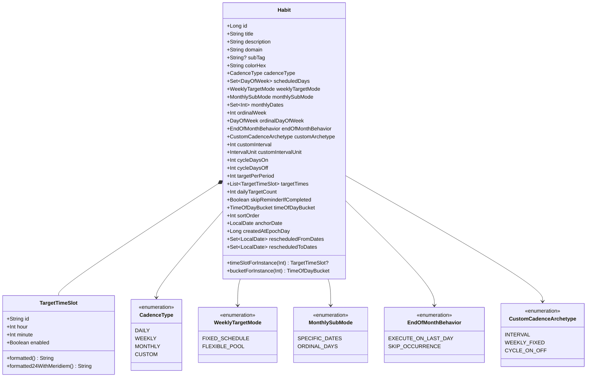
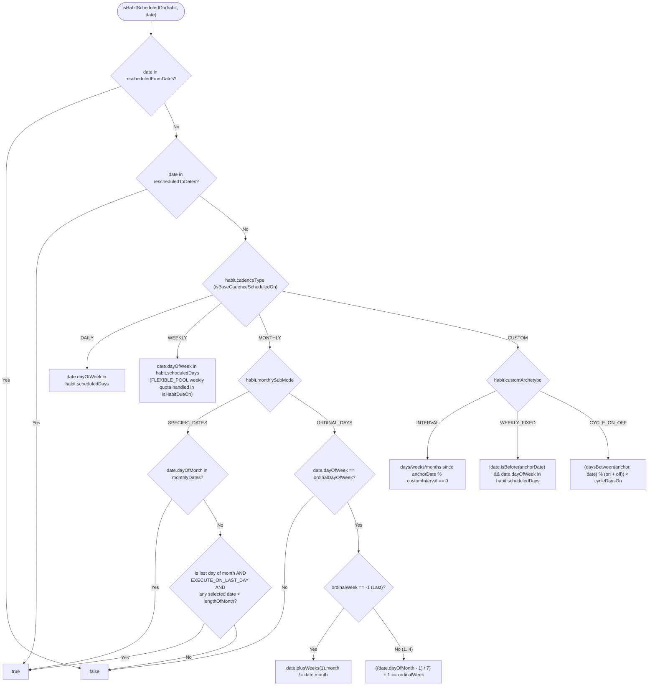

# Domain Model & Cadence Engine

All habit scheduling, streak evaluation, weekly horizon dots, and multi-week consistency matrix calculations live in [`domain/CadenceEvaluator.kt`](../app/src/main/kotlin/com/rhythm/habittracker/domain/CadenceEvaluator.kt) and [`domain/model/HabitModels.kt`](../app/src/main/kotlin/com/rhythm/habittracker/domain/model/HabitModels.kt).

---

## Domain Model Class Diagram

---

## Scheduling Evaluation (`isHabitScheduledOn`, `isHabitDueOn` & `rescheduleHabitDate`)

`CadenceEvaluator` distinguishes between two scheduling questions and keeps single-occurrence date overrides consistent:
1. **`isHabitScheduledOn(habit, date)`** — Is `date` a scheduled calendar day for `habit`? Checks single-occurrence reschedule overrides first (`date in habit.rescheduledFromDates` returns `false`; `date in habit.rescheduledToDates` returns `true`) before delegating to `isBaseCadenceScheduledOn(habit, date)`. Note that for `CadenceType.WEEKLY` with `WeeklyTargetMode.FLEXIBLE_POOL`, `isBaseCadenceScheduledOn` evaluates `date.dayOfWeek in habit.scheduledDays` so conflict checks in `RescheduleHabitDialog` do not block every calendar day.
2. **`isHabitDueOn(habit, date, completedDates)`** — Should `habit` appear on the Dashboard for `date`?
   - If `date in habit.rescheduledFromDates`, it always returns `false` first (even if stray completions existed prior to sanitization) so moved occurrences never appear on their abandoned date.
   - If `date in habit.rescheduledToDates` or `date in completedDates`, it returns `true`.
   - If the habit uses `CadenceType.WEEKLY` with `WeeklyTargetMode.FLEXIBLE_POOL`, it remains due on any non-moved day of the week (`Mon–Sun`) until `completionsThisWeek >= scheduledDays.size`, and disappears from uncompleted future/remaining days once the weekly quota is met.
   - Otherwise, it delegates to `isHabitScheduledOn(habit, date)`.
3. **`sanitizeRescheduleOverrides(habit)` & `hasCadenceChanged(old, new)`** — `sanitizeRescheduleOverrides` prunes out-of-cadence `from` dates (retaining moved flexible-pool days), prunes `to` dates already covered by the base cadence, and removes any `from`/`to` overlap. `hasCadenceChanged` compares all cadence-defining properties so non-cadence edits keep valid overrides while cadence edits clear stale overrides.
4. **`rescheduleHabitDate(habit, fromDate, toDate)`** — Sanitizes existing overrides first, then shifts an occurrence from `fromDate` to `toDate`. Rejects the shift (returns `null`) if `fromDate == toDate`, `fromDate` is not currently eligible (`fromDate in rescheduledFromDates` for `FLEXIBLE_POOL` or `!isHabitScheduledOn(sanitized, fromDate)` for fixed cadences — preventing double-reschedules), or `isHabitScheduledOn(sanitized, toDate)` is already `true`. Otherwise updates `rescheduledFromDates` and `rescheduledToDates` cleanly relative to `isBaseCadenceScheduledOn` and re-sanitizes.

---

## Supported Cadence Modes in Detail

### 1. Daily (`CadenceType.DAILY`)
- Defaults to all 7 days (`Mon–Sun`), or any subset toggled in the 7-day strip.
- Evaluates `date.dayOfWeek in habit.scheduledDays`.

### 2. Weekly (`CadenceType.WEEKLY`)
- **Quick Presets** (`WeeklyPreset`):
  - `WEEKDAYS`: `Mon–Fri` (5x/week)
  - `WEEKENDS`: `Sat–Sun` (2x/week)
  - `EVERY_OTHER_DAY`: `Mon, Wed, Fri` (3x/week)
  - `ALL`: `Mon–Sun` (7x/week)
- **Allocation Logic** (`WeeklyTargetMode`):
  - `FIXED_SCHEDULE` (*"Target per selected day"*): Habit only appears on the selected weekdays.
  - `FLEXIBLE_POOL` (*"Flexible weekly pool"*): The number of selected days defines the weekly target $N = \max(1, |\text{scheduledDays}|)$. The habit can be completed on any day between Monday and Sunday until $N$ completions are logged in that ISO week.

### 3. Monthly (`CadenceType.MONTHLY`)
- **Specific Dates (`MonthlySubMode.SPECIFIC_DATES`)**:
  - Any combination of days `1..31` selected in the 7-column Monthly Calendar Matrix or via `MonthlyDatePreset` (`1st of month`, `1st & 15th`, `Last day of month`, `Quarter start`).
  - **End-of-Month Short Dates (`EndOfMonthBehavior`)**:
    - `EXECUTE_ON_LAST_DAY`: In months with fewer than 31 days (e.g., Feb 28/29 or Apr 30), any selected date greater than `date.lengthOfMonth()` automatically rolls back and fires on the final day of that month.
    - `SKIP_OCCURRENCE`: Dates greater than `date.lengthOfMonth()` are skipped for that month.
- **Ordinal Days (`MonthlySubMode.ORDINAL_DAYS`)**:
  - Fires on the $k$-th weekday of each month (`ordinalWeek` $\in \{1, 2, 3, 4, -1\}$ where $-1$ means *Last*, paired with `ordinalDayOfWeek`).

### 4. Custom (`CadenceType.CUSTOM`)
All three custom cadence archetypes honor a user-selectable **Start Date** (`habit.anchorDate`, configurable via the Material 3 `DatePickerDialog` in `CustomCadenceBody`, defaulting to today):
- **Interval (`CustomCadenceArchetype.INTERVAL`)**:
  - Repeats every $N$ `DAYS`, `WEEKS`, or `MONTHS` anchored at `habit.anchorDate` (unscheduled before `anchorDate`).
- **Weekly Fixed (`CustomCadenceArchetype.WEEKLY_FIXED`)**:
  - Custom weekday mask with a configurable `targetPerPeriod`, active on or after `habit.anchorDate`.
- **Work Sprint / Recovery Cycle (`CustomCadenceArchetype.CYCLE_ON_OFF`)**:
  - Alternates `cycleDaysOn` active days followed by `cycleDaysOff` recovery days starting from `habit.anchorDate`.

### 5. Multi-Instance Daily Habits (`dailyTargetCount` & `targetTimes`)
- A habit scheduled on a given day expands into `habit.dailyTargetCount = max(targetTimes.size, targetPerPeriod)` individual cards on the Dashboard (`instanceIndex` in `0 until dailyTargetCount`).
- Each instance is associated with its corresponding `TargetTimeSlot` (`habit.timeSlotForInstance(instanceIndex)`) and time-of-day bucket (`habit.bucketForInstance(instanceIndex)`), allowing each instance to be checked off independently (e.g., `1/2 · 08:00 AM` and `2/2 · 08:00 PM`) and counted in its own `TimeOfDayBucket` (`MORNING`, `DURING_THE_DAY`, `EVENING`).
- A habit is considered fully completed on a date for streak calculation once all `dailyTargetCount` instances are completed on that date.

---

## Streak Calculation (`calculateStreak`, `calculateBestStreak`) & Schedule Summary

- **Standard Scheduled Habits (`calculateStreak`)**:
  - Starts scanning backward from `referenceDate` (if completed on `referenceDate`) or `referenceDate.minusDays(1)` (so an uncompleted habit today still displays its active streak from yesterday).
  - For each day walking backward (up to 1,095 days):
    - If `cursor in completedDates`: increments `streak`.
    - Else if `isHabitScheduledOn(habit, cursor)` is `true`: the streak is broken (`break`).
    - Else (unscheduled rest day): skips the day without breaking the streak.
- **Flexible Weekly Pool Habits**:
  - Counts completions in the current week (up to `referenceDate`) and walks backward week-by-week (`Mon–Sun`) for as long as each prior week met `count >= weeklyTarget`.
- **Historical Best Streak (`calculateBestStreak`)**:
  - Scans forward across the habit's history (up to 1,095 days from `min(createdAt, earliestCompletion)` through `max(referenceDate, latestCompletion)`) to compute the all-time longest streak (or consecutive qualifying weekly-pool run) and returns `max(bestRun, calculateStreak(...))`.
- **Schedule Summary (`formatHabitScheduleSummary`)**:
  - Produces uppercase Stitch telemetry strings combining cadence type, selected weekdays/dates/interval, and earliest `TargetTimeSlot` cue (used on `AllHabitsScreen` and `HabitDetailScreen`).

---

## Cadence Matrix (`buildCadenceMatrix`)

Generates a configurable `weeks`-column $\times$ 7-row (32 weeks / 224 days on Dashboard for past-only horizontal scrolling, 20 weeks / 140 days on Habit Detail) grid aligned to Monday-through-Sunday columns ending on the current week:

- For each date $d$ (future and past/present):
  - Computes `scheduledHabits = habits.filter { isHabitScheduledOn(it, d) }` and `scheduledCount = scheduledHabits.sumOf { it.dailyTargetCount }`.
  - Records `completedCount` scoped to `habits` (counting capped scheduled instance completions when scheduled, or off-schedule completions for `habits` when `scheduledCount == 0`).
  - Exposes `completionRatio = completedCount / scheduledCount` clamped to `[0f, 1f]` (or `1f` if an unscheduled past/today cell has an off-schedule completion, `0f` for future or uncompleted days).
  - Exposes `isUnscheduledEmpty = !isScheduled && (isFuture || completedCount <= 0)` so UI matrix cells render a symmetric grey `X` on days where zero tasks were scheduled (differentiating rest days from missed scheduled tasks, which remain plain grey).
  - Maps $r = \text{completionRatio}$ to `MatrixIntensity`:
    - `NONE`: $r \le 0$
    - `LOW`: $0 < r < 0.5$
    - `MEDIUM`: $0.5 \le r < 1$
    - `HIGH`: $r \ge 1$ (only when all scheduled tasks for the day are completed)
- Aggregates overall consistency percentage across all scheduled days in the window:
  $$\text{consistencyPercent} = \text{round}\left(\frac{\sum \text{completedScheduled}}{\sum \text{totalScheduled}} \times 100\right)$$

---

## Widget Telemetry Aggregation (`WidgetDataBuilder`)

[`WidgetDataBuilder.kt`](../app/src/main/kotlin/com/rhythm/habittracker/widget/WidgetDataBuilder.kt) reuses `CadenceEvaluator` rules to produce immutable, pure-Kotlin snapshots for all three home screen widgets (`SingleHabitWidgetData`, `OverallMatrixWidgetData`, `UpcomingTasksWidgetData`), ensuring multi-instance habits, reschedule overrides, task-relative heatmap intensity, unscheduled rest-day `X` markers, and time-of-day buckets match the main application 1:1.
