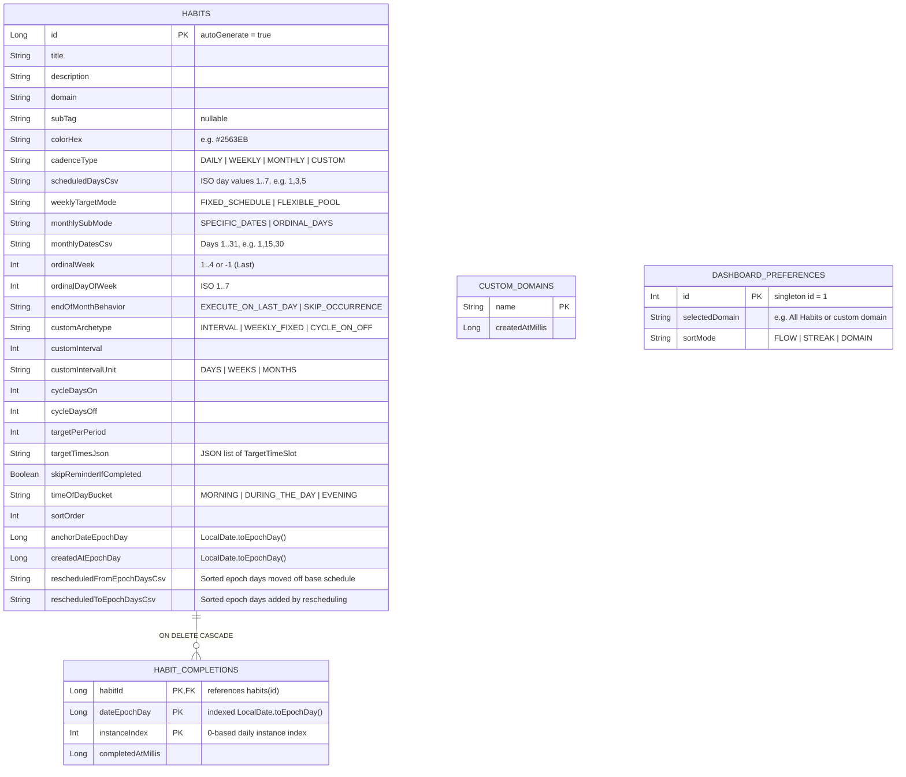
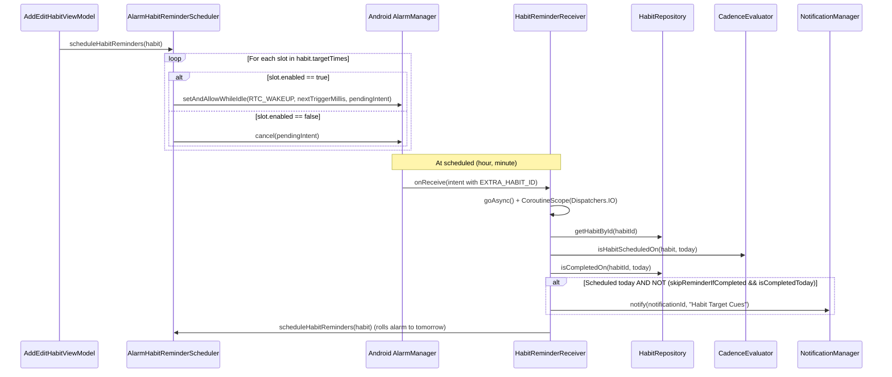

# Persistence & Reminders

Rhythm is 100% offline-first. It starts with a clean, empty state (no pre-seeded static habits or static domain lists) and uses **Room SQLite** for structured relational data (`habits`, `habit_completions`, `custom_domains`, `dashboard_preferences`), **Preferences DataStore** for temporary new-habit drafts, and Android's **`AlarmManager`** + **`BroadcastReceiver`** for scheduled habit notifications.

---

## Room Database Schema (`rhythm_habits.db`)

Defined in [`HabitDatabase.kt`](../app/src/main/kotlin/com/rhythm/habittracker/data/local/HabitDatabase.kt) (schema version `4`, with automatic migrations `MIGRATION_2_3` and `MIGRATION_3_4`) with entities in [`HabitEntity.kt`](../app/src/main/kotlin/com/rhythm/habittracker/data/local/entity/HabitEntity.kt) and queries in [`HabitDao.kt`](../app/src/main/kotlin/com/rhythm/habittracker/data/local/dao/HabitDao.kt).

### Entity-to-Domain Mapping & Persistence Rules (`HabitMapper.kt`, `HabitRepository.kt`)
- `scheduledDaysCsv` stores sorted ISO-8601 `DayOfWeek.value` integers (`1` = Monday .. `7` = Sunday).
- `monthlyDatesCsv` stores sorted day-of-month integers (`1..31`).
- `rescheduledFromEpochDaysCsv` and `rescheduledToEpochDaysCsv` store sorted `LocalDate.toEpochDay()` values used by `CadenceEvaluator.rescheduleHabitDate` when shifting single occurrences via `HabitRepository.rescheduleHabitWithUndo` (and `rescheduleHabit`).
- **Atomic Reschedule & Undo (`HabitRepository.kt`, `HabitDao.kt`)**: `RoomHabitRepository` serializes reschedule and undo operations through a `Mutex` without rewriting `custom_domains` or recalculating `sortOrder`. Room `@Transaction` helpers (`updateHabitAndClearCompletionsForDates` and `restoreHabitAndCompletionsForDates`) atomically clear completion rows for both `fromDate` and `toDate` when rescheduling, and restore `habitBefore` plus `removedCompletionsOnFromDate` if the user taps **UNDO**.
- `targetTimesJson` serializes `List<TargetTimeSlot>` via `kotlinx.serialization.json.Json`.
- Deleting a `HabitEntity` automatically cascades and deletes all associated `HabitCompletionEntity` rows (`ForeignKey.CASCADE`).
- **User-Defined Domains (`custom_domains`)**: The domain list starts empty. Adding a domain inserts into `custom_domains`; removing a domain chip (`×`) prompts a confirmation dialog in `AddEditHabitScreen` and, upon confirmation, deletes it from `custom_domains`, clears that domain tag from any habits using it, and resets the Dashboard domain filter if it was active.
- **Dashboard Filter & Sort Persistence (`dashboard_preferences`)**: Selecting a domain filter or cycling/choosing a sort mode (`FLOW`, `STREAK`, `DOMAIN`) on the Dashboard persists immediately to `dashboard_preferences`.

---

## Draft Autosave & Live Edit Autosave (`DraftHabitStore.kt`, `AddEditHabitViewModel.kt`)

- **When creating a new habit (`editingHabitId == null`)**:
  - New habit drafts are stored in Jetpack **Preferences DataStore** (`habit_draft_prefs`, key `"new_habit_draft_json"`) as a `@Serializable data class HabitDraft` (including `anchorDateEpochDay` for custom cadence start dates).
  - `init` loads any saved `HabitDraft` so backing out of the screen and tapping `+` later restores all fields.
  - Every field mutation cancels any in-flight write and queues a serialized `draftSaveJob` write (`persistDraftAsync`).
  - Tapping **Discard** cancels `draftSaveJob`, invokes `draftStore.clearDraft()`, and navigates back.
  - Tapping **Commit Habit** cancels `draftSaveJob`, saves the habit to Room, and clears the draft.
- **When editing an existing habit (`editingHabitId != null`)**:
  - Live edits are gated on `isInitialLoadComplete` and serialized through `autosaveJob` (`persistExistingHabitAsync`), persisting updates to Room (`repository.saveHabit`) and updating scheduled reminders (`CHANGES AUTOSAVED`).
  - Editing non-cadence properties (e.g., title, description, accent color) preserves sanitized `rescheduledFromDates`/`rescheduledToDates` overrides, while changing any cadence property (`CadenceEvaluator.hasCadenceChanged`) clears stale overrides automatically.
  - Navigating back via the top-left `←` button or Android system Back gesture cancels/joins `autosaveJob` and flushes any valid pending save so changes are never lost.
  - Tapping **Discard** at the bottom cancels and joins any active `autosaveJob` before restoring `initialHabitSnapshot` (including its original reschedule overrides) without leaving stray edits.

---

## Scheduled Reminders (`AlarmManager` + `HabitReminderReceiver`)

Implemented in [`HabitReminderScheduler.kt`](../app/src/main/kotlin/com/rhythm/habittracker/reminders/HabitReminderScheduler.kt) and [`HabitReminderReceiver.kt`](../app/src/main/kotlin/com/rhythm/habittracker/reminders/HabitReminderReceiver.kt).

### Key Behaviors
- **Per-Instance Smart Suppression**: If `habit.skipReminderIfCompleted` is enabled and the user has already checked off that reminder slot's instance (or all daily instances of the habit) today, `HabitReminderReceiver` silently suppresses the notification and reschedules the alarm for the next day.
- **Automatic Notification Dismissal on Completion**: Completing a habit instance (via `DashboardViewModel.toggleHabitCompletion`, the interactive Home Screen `UpcomingTasksWidgetProvider`, or reactively in `RhythmApplication`) automatically dismisses active status-bar notifications for that task via `ReminderScheduler.dismissHabitNotification` (canceling by per-slot/legacy notification IDs as well as active notifications carrying `EXTRA_HABIT_ID` and `EXTRA_SLOT_INDEX` extras). Rescheduling off the day or deleting a habit likewise clears all active notifications for that habit.
- **Android 13+ (`API 33+`) Runtime Permission**: `AddEditHabitScreen` requests `android.permission.POST_NOTIFICATIONS` via `ActivityResultContracts.RequestPermission()` when enabling a time-slot cue or committing a habit with active reminders.

---

## Home Screen Widget Preferences & Reactive Sync

- **Per-Widget Settings (`WidgetPreferencesStore`)**: Stored in `SharedPreferences` (`"rhythm_widget_prefs"`), keyed by `appWidgetId`, persisting `WidgetThemeMode` (`LIGHT` / `DARK`) for all widgets and the configured `habitId` for `HabitCadenceWidgetProvider`. Deleted widget IDs are cleaned up automatically in each provider's `onDeleted`.
- **Automatic Live Updates (`RhythmApplication` & `RhythmWidgetUpdater`)**: [`RhythmApplication`](../app/src/main/kotlin/com/rhythm/habittracker/RhythmApplication.kt) observes `observeHabits()` and `observeCompletedInstancesByDate()` on an `applicationScope` and pushes fresh `RemoteViews` via `RhythmWidgetUpdater.updateAllWidgetsWithSnapshot(...)`. Tapping a task row inside `UpcomingTasksWidgetProvider` toggles completion via `RoomHabitRepository.toggleCompletion` and calls `RhythmWidgetUpdater.updateAllWidgets(context)` inside `goAsync()`.
