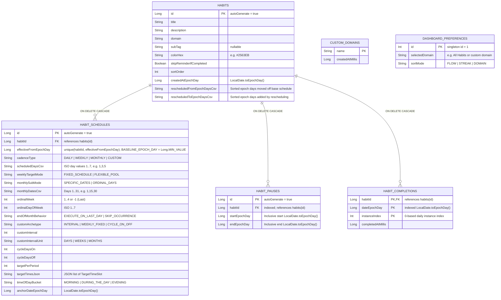
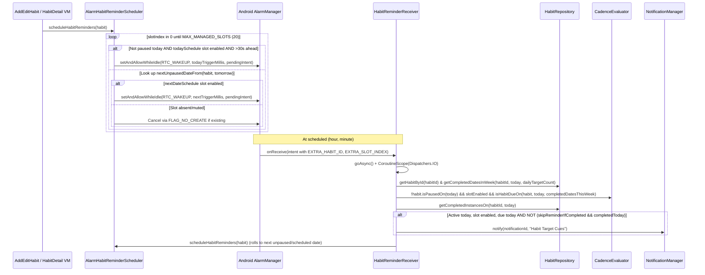

# Persistence & Reminders

Rhythm is 100% offline-first. It starts with a clean, empty state (no pre-seeded static habits or static domain lists) and uses **Room SQLite** for structured relational data (`habits`, `habit_schedules`, `habit_pauses`, `habit_completions`, `custom_domains`, `dashboard_preferences`), **Preferences DataStore** for temporary new-habit drafts, and Android's **`AlarmManager`** + **`BroadcastReceiver`** for scheduled habit notifications.

---

## Room Database Schema (`rhythm_habits.db`)

Defined in [`HabitDatabase.kt`](../app/src/main/kotlin/com/rhythm/habittracker/data/local/HabitDatabase.kt) (schema version `5`, with migrations `MIGRATION_2_3`, `MIGRATION_3_4`, and lossless `MIGRATION_4_5`) with entities in [`HabitEntity.kt`](../app/src/main/kotlin/com/rhythm/habittracker/data/local/entity/HabitEntity.kt) and queries in [`HabitDao.kt`](../app/src/main/kotlin/com/rhythm/habittracker/data/local/dao/HabitDao.kt).

### Entity-to-Domain Mapping, Migration & Persistence Rules (`HabitMapper.kt`, `HabitRepository.kt`)
- **Modular Mapping (`HabitWithDetails`)**: `HabitDao` loads each `HabitEntity` alongside its `HabitScheduleEntity` versions and `HabitPauseEntity` ranges using Room `@Transaction` `@Relation` queries (`observeHabitsWithDetails`, `getAllHabitsWithDetails`, `getHabitWithDetailsById`). `HabitMapper` reconstructs sorted `HabitSchedule` lists (mapping `HabitSchedule.BASELINE_EPOCH_DAY = Long.MIN_VALUE` back to `effectiveFrom = null`) and normalized `HabitPauseWindow` lists.
- **Lossless v4 -> v5 Migration (`MIGRATION_4_5`)**: Upgrades existing v4 databases in place without losing any habits, schedule rules, completions, or IDs:
  1. Captures `sqlite_sequence` for `habits` before table rebuild so deleted habit IDs are never reused.
  2. Backs up and drops `habit_completions` temporarily so no foreign key references `habits` during table rebuild.
  3. Stages v4 schedule columns into `habit_schedules_tmp` binding `HabitSchedule.BASELINE_EPOCH_DAY` as a `Long` parameter (avoiding SQLite literal coercion of `Long.MIN_VALUE`), rebuilds `habits` with the 11 lean identity/reschedule columns, and restores `sqlite_sequence`.
  4. Creates `habit_schedules` (unique index on `(habitId, effectiveFromEpochDay)`, `ON DELETE CASCADE`), `habit_pauses` (indexed on `habitId`, `ON DELETE CASCADE`), and recreates `habit_completions` (`ON DELETE CASCADE` + `dateEpochDay` index), restoring staged rows guarded by `WHERE habitId IN (SELECT id FROM habits)`.
- **Serialized Mutations & Pause Operations (`HabitRepository.kt`, `HabitDao.kt`)**:
  - `RoomHabitRepository` serializes all `saveHabit`, `pauseHabit`, `resumeOrCancelPause`, `rescheduleHabitWithUndo`, and `undoReschedule` writes through a unified `habitMutationMutex` (`insertHabit` uses `OnConflictStrategy.ABORT`; `upsertHabitWithDetails` atomically saves `HabitEntity` + schedules + pauses; `replacePausesForHabit` replaces pause windows cleanly).
  - `scheduledDaysCsv` stores sorted ISO-8601 `DayOfWeek.value` integers (`1..7`); `monthlyDatesCsv` stores sorted day-of-month integers (`1..31`); `rescheduledFromEpochDaysCsv`/`rescheduledToEpochDaysCsv` store sorted epoch days; `targetTimesJson` serializes `List<TargetTimeSlot>` via `kotlinx.serialization.json.Json`.
  - Room `@Transaction` helpers (`updateRescheduleAndClearCompletionsForDates` using targeted `updateRescheduleOverrides`, and `restoreRescheduleAndCompletionsForDates`) atomically clear/restore completion rows without touching schedules or pauses; `undoReschedule` rejects stale tokens if `CadenceEvaluator.hasHabitScheduleOrPauseChanged` is true.
  - `getCompletedDatesInWeek` queries `getCompletionsForHabitInRange` across the ISO `Mon–Sun` week and evaluates each day against `habit.scheduleForDate(d).dailyTargetCount`.
- **User-Defined Domains (`custom_domains`) & Dashboard Prefs (`dashboard_preferences`)**: `custom_domains` starts empty; removing a domain chip (`×`) prompts confirmation before deleting the domain, clearing tags from habits, and resetting the Dashboard domain filter if active.

---

## Draft Autosave vs. Staged Existing-Habit Edits (`DraftHabitStore.kt`, `AddEditHabitViewModel.kt`)

- **When creating a new habit (`editingHabitId == null`)**:
  - New habit drafts live-autosave in Jetpack **Preferences DataStore** (`habit_draft_prefs`, key `"new_habit_draft_json"`) as a `@Serializable data class HabitDraft` (`DRAFT AUTOSAVED` badge), queued via `draftSaveJob` (`persistDraftAsync`).
  - **Discard** clears the draft; **Commit Habit** cancels `draftSaveJob`, inserts into Room, schedules reminders, and clears the draft.
- **When editing an existing habit (`editingHabitId != null`)**:
  - Live Room autosave is replaced by **staged in-memory editing** (`hasUnsavedChanges`, badge showing `UP TO DATE` or `UNSAVED CHANGES`).
  - Identity and reminder-only edits save directly habit-wide via `applyIdentityAndReminderOnlyEdit` without prompting.
  - Schedule rule, `dailyTargetCount`, or target-time changes (`hasScheduleOrTimesChanged`) open `SaveScopeDialog` on **Save Changes**, offering **Future occurrences only** (`HabitEditScope.FUTURE_ONLY` starting today or tomorrow if completed today) vs. **All occurrences** (`HabitEditScope.ALL_OCCURRENCES`).
  - Navigating Back with `hasUnsavedChanges == true` opens `UnsavedChangesDialog` (*Save Changes / Discard Changes / Keep Editing*) rather than writing unconfirmed retroactive edits.

---

## Scheduled Reminders (`AlarmManager` + `HabitReminderReceiver`)

Implemented in [`HabitReminderScheduler.kt`](../app/src/main/kotlin/com/rhythm/habittracker/reminders/HabitReminderScheduler.kt) and [`HabitReminderReceiver.kt`](../app/src/main/kotlin/com/rhythm/habittracker/reminders/HabitReminderReceiver.kt).

### Key Behaviors
- **Date-Aware Smart-Cutoff & Slot Cleanup**: `AlarmHabitReminderScheduler` scans `MAX_MANAGED_SLOTS = 20` slot indices, scheduling today against `habit.scheduleForDate(today)` (when unpaused) and future alarms against `habit.scheduleForDate(nextUnpausedDateFrom(habit, tomorrow))` so smart-cutoff `"starts tomorrow"` edits and upcoming pauses transition seamlessly, while cancelling removed slots cleanly using `PendingIntent.FLAG_NO_CREATE`.
- **Pause & Per-Instance Smart Suppression**: `HabitReminderReceiver` suppresses notifications whenever `habit.isPausedOn(today)` is true, the target slot is muted (`!slotEnabled`), the habit is not due (`!CadenceEvaluator.isHabitDueOn` including weekly flexible pools), or `habit.skipReminderIfCompleted` is enabled and that `slotIndex` / `todaySchedule.dailyTargetCount` is already complete.
- **Android 13+ (`API 33+`) Runtime Permission**: `AddEditHabitScreen` requests `android.permission.POST_NOTIFICATIONS` via `ActivityResultContracts.RequestPermission()` when enabling a time-slot cue or committing a habit with active reminders.

---

## Home Screen Widget Preferences & Reactive Sync

- **Per-Widget Settings (`WidgetPreferencesStore`)**: Stored in `SharedPreferences` (`"rhythm_widget_prefs"`), keyed by `appWidgetId`, persisting `WidgetThemeMode` (`LIGHT` / `DARK`) for all widgets and the configured `habitId` for `HabitCadenceWidgetProvider`. Deleted widget IDs are cleaned up automatically in each provider's `onDeleted`.
- **Automatic Live Updates (`RhythmApplication` & `RhythmWidgetUpdater`)**: [`RhythmApplication`](../app/src/main/kotlin/com/rhythm/habittracker/RhythmApplication.kt) observes `observeHabits()` and `observeCompletedInstancesByDate()` on an `applicationScope` and pushes fresh `RemoteViews` via `RhythmWidgetUpdater.updateAllWidgetsWithSnapshot(...)`. Tapping a task row inside `UpcomingTasksWidgetProvider` toggles completion via `RoomHabitRepository.toggleCompletion` and calls `RhythmWidgetUpdater.updateAllWidgets(context)` inside `goAsync()`.
