# UI & Design System ("Functional Habit Architecture")

Rhythm's interface translates the **Minimalist Habit Tracker** design system from Google Stitch (`Project ID: 11168505724477891257`) into Jetpack Compose. The aesthetic pairs a high-contrast Swiss monochrome surface hierarchy with tabular monospace telemetry (`JetBrains Mono`) and purposeful semantic accents.

---

## Stitch Screen-to-Code Mapping

| Stitch Screen | Stitch Screen ID | Compose Implementation | `@Preview` Function |
| :--- | :--- | :--- | :--- |
| **1. Habit Tracker Dashboard** | `ecc564db067b41808bf408fee48dafb4` | [`DashboardScreen.kt`](../app/src/main/kotlin/com/rhythm/habittracker/ui/dashboard/DashboardScreen.kt) | `DashboardScreenPreview` |
| **2. Add Habit — Daily Cadence** | `4934b3bada29486e9438a3c5a250af4d` | [`AddEditHabitScreen.kt`](../app/src/main/kotlin/com/rhythm/habittracker/ui/addhabit/AddEditHabitScreen.kt) (`DailyCadenceBody`) | `AddHabitDailyPreview` |
| **3. Add Habit — Weekly Cadence** | `832af98377f54eba9577f5bde2c6b710` | [`AddEditHabitScreen.kt`](../app/src/main/kotlin/com/rhythm/habittracker/ui/addhabit/AddEditHabitScreen.kt) (`WeeklyCadenceBody`) | `AddHabitWeeklyPreview` |
| **4. Add Habit — Monthly Cadence** | `e8b9eae435e14d0bbbadb3e2e8c3ca27` | [`AddEditHabitScreen.kt`](../app/src/main/kotlin/com/rhythm/habittracker/ui/addhabit/AddEditHabitScreen.kt) (`MonthlyCadenceBody`) | `AddHabitMonthlyPreview` |
| **5. Add Habit — Custom Cadence** | `ff35a2eca9f846debd16983699371713` | [`AddEditHabitScreen.kt`](../app/src/main/kotlin/com/rhythm/habittracker/ui/addhabit/AddEditHabitScreen.kt) (`CustomCadenceBody`) | Interactive tab in `AddEditHabitScreenContent` |
| **6. All Habits List** | `ac8b4007866545bb8ddf54fa73295083` | [`AllHabitsScreen.kt`](../app/src/main/kotlin/com/rhythm/habittracker/ui/allhabits/AllHabitsScreen.kt) (`AllHabitsScreenContent`) | `AllHabitsScreenPreview` |
| **7. Habit Detail** | `cbe16b2f91894af6ae276003fd827158` | [`HabitDetailScreen.kt`](../app/src/main/kotlin/com/rhythm/habittracker/ui/habitdetail/HabitDetailScreen.kt) (`HabitDetailScreenContent`) | `HabitDetailScreenPreview` |
| **8. Widget: Single-Habit Matrix (2x4 / 4x2 / 4x4)** | `5475f6c0e58443aebd9671729c58cdec`, `c3b78f3697cf4eb3b450853f32a7ec43`, `cc98f740ed2b4eb4952b56fac2407a86` | [`HabitCadenceWidgetProvider.kt`](../app/src/main/kotlin/com/rhythm/habittracker/widget/HabitCadenceWidgetProvider.kt) + [`WidgetBitmapRenderer.kt`](../app/src/main/kotlin/com/rhythm/habittracker/widget/WidgetBitmapRenderer.kt) | `SingleHabitWideLightPreview`, `SingleHabitSquareDarkPreview` |
| **9. Widget: Overall Matrix (2x4 / 4x3 / 4x4)** | `896bf24880fe441eb4097d17bf4f5168`, `5be7f99a596e40fdb2c2f1370f329556`, `458c172f32f243cc9219a3149c10915d` | [`OverallCadenceWidgetProvider.kt`](../app/src/main/kotlin/com/rhythm/habittracker/widget/OverallCadenceWidgetProvider.kt) + [`WidgetBitmapRenderer.kt`](../app/src/main/kotlin/com/rhythm/habittracker/widget/WidgetBitmapRenderer.kt) | `OverallMatrixSquareLightPreview`, `OverallMatrixTallDarkPreview` |
| **10. Widget: Upcoming Tasks (2x4 / 4x3 / 4x4)** | `664f1de5cf594674b3556080eb93bdc8`, `8d9aa2b85a6544509007627beaedd7ba`, `8fda9a7f4ea147f19a33a43a46b125f1` | [`UpcomingTasksWidgetProvider.kt`](../app/src/main/kotlin/com/rhythm/habittracker/widget/UpcomingTasksWidgetProvider.kt) + [`WidgetBitmapRenderer.kt`](../app/src/main/kotlin/com/rhythm/habittracker/widget/WidgetBitmapRenderer.kt) | `UpcomingTasksSquareLightPreview`, `UpcomingTasksTallDarkPreview` |

---

## Color System ([`Color.kt`](../app/src/main/kotlin/com/rhythm/habittracker/ui/theme/Color.kt))

### 1. Monochrome Surface Spectrum

| Token | Hex | Role |
| :--- | :--- | :--- |
| `RhythmSurface` / `RhythmBackground` | `#F8F9FB` | Cool alabaster app canvas |
| `RhythmSurfaceContainerLowest` | `#FFFFFF` | Elevated cards, active pills, dialogs |
| `RhythmSurfaceContainerLow` | `#F3F4F6` | Input fields, inactive segmented tracks, subtle strips |
| `RhythmSurfaceContainer` | `#EDEEF0` | Dividers, inactive heatmap cells, progress tracks |
| `RhythmSurfaceContainerHigh` | `#E7E8EA` | Card hairline borders (`1.dp`), inactive switch tracks |
| `RhythmPrimary` | `#000000` | Primary CTAs, active tabs, selected day pills |
| `RhythmDeepGraphite` | `#121417` | Brand mark container, toast surfaces, selected calendar dates |
| `RhythmSecondary` | `#575F67` | Technical metadata labels |
| `RhythmOnSurface` | `#191C1E` | Primary ink for titles and body copy |
| `RhythmOnSurfaceVariant` | `#45474A` | Secondary ink for subtitles and unselected controls |
| `ConsistencyEmerald` | `#10B981` | 32-week Dashboard Cadence Matrix heatmap & active status dots |
| `RhythmError` | `#BA1A1A` | Validation errors and destructive actions |

### 2. Seven Habit Accent Signatures (`HabitAccentColor`)

Defined in [`HabitModels.kt`](../app/src/main/kotlin/com/rhythm/habittracker/domain/model/HabitModels.kt):
- `ROYAL_BLUE` — `#2563EB`
- `EMERALD_GREEN` — `#10B981`
- `WARM_AMBER` — `#D97706`
- `SKY_BLUE` — `#0284C7`
- `ROSE_CORAL` — `#F43F5E`
- `VIOLET_PURPLE` — `#8B5CF6`
- `SLATE_GRAPHITE` — `#475569`

Each habit's accent color styles its `4.dp` left card indicator bar, domain/sub-tag badge tint, streak flame icon, and tactile checkbox border/fill. Every `HabitCard` renders its scheduled time pill (e.g., `08:00 AM` for single-occurrence habits, or `1/2 · 08:00 AM` / `2/2 · 08:00 PM` when a habit has multiple daily instances so each instance can be checked off independently between **To Do Today** and **Completed**).

---

## Typography Scale ([`Type.kt`](../app/src/main/kotlin/com/rhythm/habittracker/ui/theme/Type.kt))

Bundled TTF font families under `app/src/main/res/font/`:
- **`InterFontFamily`** (`inter_regular`, `inter_medium`, `inter_semibold`, `inter_bold`) — Editorial headings and descriptions.
- **`JetBrainsMonoFontFamily`** (`jetbrains_mono_regular`, `jetbrains_mono_medium`, `jetbrains_mono_semibold`, `jetbrains_mono_bold`) — Tabular numerals (`fontFeatureSettings = "tnum"`), counters, timestamps, and architectural section headers.

| Token (`RhythmTheme.tokens`) | Font Family | Weight | Size / Line Height | Letter Spacing | Primary Usage |
| :--- | :--- | :--- | :--- | :--- | :--- |
| `displayMobile` | Inter | Bold | `40.sp` / `44.sp` | `-0.025.em` | Hero display headers |
| `headlineLgMobile` | Inter | Bold | `26.sp` / `32.sp` | `-0.015.em` | `"Today"`, `"Today's Progress"` |
| `headlineMd` | Inter | SemiBold | `22.sp` / `28.sp` | `-0.01.em` | `"New Habit"`, dialog titles |
| `bodyLg` | Inter | Normal | `16.sp` / `24.sp` | `-0.005.em` | Habit card titles, text inputs |
| `bodyMd` | Inter | Normal | `14.sp` / `20.sp` | `0.em` | Card descriptions, option titles |
| `bodySm` | Inter | Normal | `12.sp` / `16.sp` | `0.01.em` | Helper captions, radio subtitles |
| `counterHeroMobile` | JetBrains Mono | Bold | `36.sp` / `36.sp` | `-0.03.em` | `4 / 6` daily progress fraction |
| `counterMd` | JetBrains Mono | SemiBold | `18.sp` / `20.sp` | `-0.02.em` | Medium numeric readouts |
| `counterSm` | JetBrains Mono | Bold | `12.sp` / `16.sp` | `-0.01.em` | Bucket fractions (`2/2`), streak counts |
| `labelMd` | JetBrains Mono | Medium | `11.sp` / `14.sp` | `0.06.em` | Filter chips, buttons, segmented tabs |
| `labelSm` | JetBrains Mono | Medium | `10.sp` / `12.sp` | `0.08.em` | Uppercase section headers & badges |

---

## Screen Component Hierarchy

```mermaid
flowchart TD
    MainNav["MainNavigation (Navigation.kt)"] --> Dash["DashboardScreen"]
    MainNav --> All["AllHabitsScreen"]
    MainNav --> Detail["HabitDetailScreen"]
    MainNav --> AddEdit["AddEditHabitScreen"]

    subgraph DashboardTree["DashboardScreen Component Tree"]
        Dash --> TopBar["DashboardTopBar\n(RhythmBrandMark + Sort Menu + RhythmProfileAvatar)"]
        Dash --> Hero["ProgressAnchorSection\n(Date/Week + 4/6 Counter)"]
        Dash --> Matrix["CadenceMatrixCard\n(32-Week Scrollable Emerald Heatmap + All 7 Day Labels + Consistency Badge)"]
        Dash --> Horizon["WeeklyHorizonStrip\n(7-Day Mon..Sun Selector)"]
        Dash --> Buckets["DayPartProgressSection\n(3 TimeBucketCards: Morning / During the day / Evening)"]
        Dash --> Filters["FilterContextStrip\n(All Habits / Mind / Health / Focus + Sort Cycler)"]
        Dash --> Pending["HabitCard (Pending Section -> HabitDetail)"]
        Dash --> Completed["HabitCard (Completed Section -> HabitDetail)"]
        Dash --> Momentum["MomentumInsightFooter"]
        Dash --> ExpandFab["ExpandableDashboardFab\n(Add Habit / All Habits)"]
    end

    subgraph AllHabitsTree["AllHabitsScreen Component Tree"]
        All --> AllTop["AllHabitsTopBar"]
        All --> InvStats["SystemInventoryHeader\n(Total / Mean Streak / Completion %)"]
        All --> QueryTools["HabitSearchBar + Domain Count Chips"]
        All --> Feed["AllHabitCard Feed (Tap -> Detail, Edit -> Edit) / ZeroCadencesFoundCard"]
    end

    subgraph HabitDetailTree["HabitDetailScreen Component Tree"]
        Detail --> DetTop["HabitDetailTopBar"]
        Detail --> Overview["HabitOverviewCard\n(Current / Best / Rate Metrics)"]
        Detail --> DetMatrix["HabitCompletionMatrixCard\n(20-Week Accent-Tinted Matrix)"]
        Detail --> TargetRo["TargetScheduleReadOnlyCard"]
        Detail --> RecentRun["RecentRunWeekCard (7-Day Strip)"]
        Detail --> EditCta["Edit Habit Button -> AddEditHabitScreen"]
    end

    subgraph AddEditTree["AddEditHabitScreen Component Tree"]
        AddEdit --> Header["AddEditTopHeader\n(Back + RhythmBrandMark + ARCHITECT / DRAFT AUTOSAVED)"]
        AddEdit --> Identity["IdentityAndSignatureCard\n(Title 0/48 + Description + Domain FlowRow w/ Delete Confirm + 7 Color Swatches)"]
        AddEdit --> Engine["CadenceEngineCard\n(4-Way Segmented Switcher)"]
        Engine --> C1["DailyCadenceBody"]
        Engine --> C2["WeeklyCadenceBody\n(Weekday Pills + Quick Presets + Allocation Mode)"]
        Engine --> C3["MonthlyCadenceBody\n(Specific Dates 1..31 Grid / Ordinal Picker + EOM Rules)"]
        Engine --> C4["CustomCadenceBody\n(Interval / Weekly / Cycle Steppers + Start Date Picker + 30-Day Projection)"]
        AddEdit --> Times["TargetTimesCard\n(TimePicker Cues + RhythmTactileSwitch + Skip Toggle)"]
        AddEdit --> Footer["FooterActionsSection\n(Discard / Commit Habit / Delete Habit)"]
    end
```

---

## Shared Tactile Components & App Icon ([`RhythmComponents.kt`](../app/src/main/kotlin/com/rhythm/habittracker/ui/components/RhythmComponents.kt))

- **Launcher App Icon (`ic_launcher` / `ic_launcher_round`)**: Uses the exact `RhythmBrandMark` vector geometry — a `2x2` Swiss geometric cadence grid (top-left, bottom-left, bottom-right `#FFFFFF` at 100%, top-right `#FFFFFF` at 45% opacity) centered on `#121417` (`RhythmDeepGraphite`) in [`ic_launcher_background.xml`](../app/src/main/res/drawable/ic_launcher_background.xml) and [`ic_launcher_foreground.xml`](../app/src/main/res/drawable/ic_launcher_foreground.xml).
- **`RhythmBrandMark`**: `2x2` Swiss geometric cadence grid rendered on a `RhythmDeepGraphite` rounded square (`32.dp` on Dashboard, `24.dp` on Add/Edit header).
- **`RhythmProfileAvatar`**: Circular `32.dp` action button opening the overall **Habit Architecture Summary** modal on the Dashboard or the **Habit Architect Spec** modal on the Add/Edit screen.
- **`RhythmTactileSwitch`**: Custom spring-animated pill toggle (`42.dp` $\times$ `24.dp`) with optional embedded notification bell icon (`showBellIcon = true`) used in the `TargetTimesCard`.
- **`RhythmMatrixCell` & `rhythmMatrixCellColor`**: Shared completion matrix square and color-scaling helper used by `DashboardScreen` (32-week horizontally past-scrollable grid anchored on the current week at the right edge, with fixed `M, T, W, T, F, S, S` day-initial axis on the left and rendered in `ConsistencyEmerald`), `HabitDetailScreen` (20-week grid in the habit's `HabitAccentColor`), and future completion grids. Scales fill intensity continuously from `emptyColor` (`completionRatio == 0f`) through proportionally interpolated tint (`0.24f + 0.52f * completionRatio`) up to full `activeColor` (`completionRatio >= 1f`, all scheduled tasks done), and draws a symmetric grey `X` via `drawWithContent` with `StrokeCap.Round` when `isUnscheduledEmpty` is true (zero scheduled tasks and uncompleted) so unscheduled rest days stay visually distinct from missed scheduled days.
- **`RhythmConfettiOverlay`**: Non-interactive physics-driven `Canvas` confetti burst (ribbons, geometric squares, and circles) triggered on the Dashboard when the user completes a day-part bucket (bursting directly from that bucket's `TimeBucketCard` progress bar via `emitterOriginFractions`) or completes the final scheduled habit instance of a day.

---

## Motion & Micro-Interactions

- **Route Transitions ([`Navigation.kt`](../app/src/main/kotlin/com/rhythm/habittracker/Navigation.kt))**: `NavDisplay` uses directional horizontal slide + fade transitions (`transitionSpec`, `popTransitionSpec`, `predictivePopTransitionSpec`) across `DashboardRoute`, `AllHabitsRoute`, `HabitDetailRoute`, and `AddEditHabitRoute`.
- **Dashboard Expandable Navigation & Card Flow ([`DashboardScreen.kt`](../app/src/main/kotlin/com/rhythm/habittracker/ui/dashboard/DashboardScreen.kt))**:
  - `ExpandableDashboardFab`: Tapping the bottom-right `+` button rotates the icon `45°`, fades in a dismissible scrim, and reveals a vertical list of floating navigation pills (`ADD HABIT` and `ALL HABITS`) with bouncy spring entry animations.
  - Tapping a `HabitCard` on the Dashboard navigates to `HabitDetailRoute(habitId)` rather than directly to the editor; editing is launched via the bottom **Edit Habit** button on `HabitDetailScreen` (or the per-card **EDIT** button on `AllHabitsScreen`). All Dashboard `HabitCard` items display their scheduled time pill (combining instance progress like `1/2 · 08:00 AM` when a habit has multiple occurrences per day).
- **Dashboard List & Telemetry ([`DashboardScreen.kt`](../app/src/main/kotlin/com/rhythm/habittracker/ui/dashboard/DashboardScreen.kt))**:
  - **Cancelable Bouncy Prismatic Checking Wave Animation**: Tapping an uncompleted `HabitCard` checkbox runs a ~`1.17s` (`1050ms` wave sweep + `120ms` settle) celebratory sequence (`waveJob`) before calling `onToggleHabit(habit.id, instanceIndex, cardDate)` and reordering: both the entire card (`0.94f -> 1.045f -> 1.0f`) and checkbox (`0.78f -> 1.38f -> 1.0f`) squish and spring-bounce with high-bouncy physics while `Modifier.drawWithContent` renders a multi-tone aurora wash, three staggered prismatic radial waves (`WaveColorPalette`), ten fizzing color orbs, and a glowing gradient card border anchored in the card's `HabitAccentColor`. Tapping the checkbox again mid-wave or starting a horizontal swipe immediately cancels `waveJob` and resets wave visuals without toggling completion; external completion (`LaunchedEffect(item.isCompleted, selectedDate)`) also cancels any active wave.
  - **Cancelable Swipe-to-Reschedule (`RescheduleHabitDialog`) & Undo Banner**: `HabitCard` uses stationary-coordinate `detectHorizontalDragGestures` with a positional `96.dp` threshold (capped at `148.dp` raw drag with `0.48f` rubber-band damping beyond threshold and no velocity-fling dismissal). Dragging reveals `"SWIPE TO RESCHEDULE"` -> `"RELEASE TO RESCHEDULE"`; sliding back below threshold or canceling the gesture springs back cleanly without opening the modal. Releasing past threshold opens `RescheduleHabitDialog` backed by a live `reschedulingTarget` lookup, with quick-shift chips (`Tomorrow`, `+2 Days`, `Next Week`) and a full month calendar grid where scheduled dates (`CadenceEvaluator.isHabitScheduledOn`) show an accent dot, display a conflict warning, and disable `Reschedule`. Confirming displays a 4.5-second floating bottom **UNDO** banner (`RescheduleBanner`) that atomically reverts the shift and any cleared completions.
  - Date-scoped `LazyColumn` item keys (`"habit_${uiState.selectedDate}_${it.habit.id}_${it.instanceIndex}"`) paired with medium-bouncy, low-stiffness `Modifier.animateItem` spring placement (`Spring.DampingRatioMediumBouncy`, `Spring.StiffnessLow`) so checking/unchecking a habit or changing sort modes glides cards smoothly without leaking animation state across selected dates.
  - **Due-Time Task Ordering & Layout Placement**: `DashboardViewModel` orders both **To Do Today** and **Completed** lists chronologically by each instance's scheduled due time (`timeSlot.minuteOfDay`, with `sortOrder`, `instanceIndex`, and `id` as tie-breakers in `FLOW` mode and as secondary tie-breakers in `STREAK`/`DOMAIN` modes). `DayPartProgressSection` (the three `TimeBucketCard` progress bars) sits directly below `WeeklyHorizonStrip` and immediately above `FilterContextStrip`.
  - **Day-Part Completion Confetti (`DayPartCelebrationOverlay`)**: Completing the final pending task in a `TimeOfDayBucket` triggers `RhythmConfettiOverlay` originating directly from that `TimeBucketCard` bar while the bar smoothly fills to 100% and transitions to `ConsistencyEmerald`.
  - Spring-bounced checkbox completion scale + `AnimatedVisibility` checkmark icon, haptic feedback, odometer-style `AnimatedContent` counters, spring-interpolated bucket progress bars (turning `ConsistencyEmerald` at 100%), task-relative `RhythmMatrixCell` heatmap squares (scaling proportionally with `completedCount / scheduledCount` and showing a symmetric grey `X` on unscheduled empty days), and celebratory `RhythmConfettiOverlay` upon completing the last task of the day.
- **Cadence Engine & Architect Modals ([`AddEditHabitScreen.kt`](../app/src/main/kotlin/com/rhythm/habittracker/ui/addhabit/AddEditHabitScreen.kt))**:
  - Directional `AnimatedContent` + `animateContentSize` when switching between `DAILY`, `WEEKLY`, `MONTHLY`, and `CUSTOM` tabs or adding/removing target time slots.
  - **Custom Cadence Start Date Picker**: `CustomCadenceBody` includes a clickable **Start Date** row opening a Material 3 `DatePickerDialog` to anchor interval, cycle, and custom-weekly habits on any date (updating the 30-day projection matrix immediately).
  - **Domain Deletion Confirmation Modal**: Tapping the `×` icon on any Domain/Tag chip opens a confirmation `AlertDialog` before removing the domain from `custom_domains` and clearing it from assigned habits.

---

## Android Home Screen Widgets ([`widget/`](../app/src/main/kotlin/com/rhythm/habittracker/widget/WidgetBitmapRenderer.kt))

All three home screen widgets adapt smoothly across arbitrary resized cell bounds (covering Tall `2×4`, Wide `4×2` / `4×3`, Square `4×4`, and intermediate dimensions) and share consistent typography (`Inter` + `JetBrains Mono`), completion-relative matrix intensity, and symmetric grey `X` markers on unscheduled rest days:

1. **Habit Cadence Matrix (`HabitCadenceWidgetProvider`)**:
   - Displays a user-selected habit's streak flame badge, domain/sub-tag indicator, consistency rate, primary target time, responsive multi-week accent-colored completion matrix (with all `M–S` weekday labels), and today's status.
   - Tapping launches [`MainActivity`](../app/src/main/kotlin/com/rhythm/habittracker/MainActivity.kt) directly to that habit's `HabitDetailRoute` via `EXTRA_OPEN_HABIT_ID`.
2. **Overall Cadence Matrix (`OverallCadenceWidgetProvider`)**:
   - Displays Morning/Afternoon/Evening daily progress bars (stacked on narrow tall widgets, 3-card row on wide/square widgets), overall consistency %, streak + monthly completions summary, responsive emerald cadence matrix with month headers and `M–S` initials, and the next scheduled task. Tapping opens the Dashboard.
3. **Upcoming Tasks (`UpcomingTasksWidgetProvider`)**:
   - Displays today's date/completion pill, a multi-color segmented progress bar colored by completed habit accents, an ordered task checklist (pending tasks with a `NOW` pill sorted by time above completed items), and a footer summary.
   - Built with piecewise `RemoteViews` (`widget_upcoming_tasks.xml`) so tapping any task row directly toggles that `(habitId, instanceIndex)` completion in Room (`ACTION_TOGGLE_TASK`) and refreshes all widgets in place without opening the app.
4. **Reconfigurable Settings (`WidgetConfigActivity`)**:
   - All 3 widgets declare `android:widgetFeatures="reconfigurable"` and launch `WidgetConfigActivity`, offering a live size-tab preview (`2×4 Tall`, `4×2 / 4×3`, `4×4 Square`), **Light Mode** vs. **Dark Mode** surface switching for every widget, and an interactive **Target Habit** selector for the Single-Habit widget.
5. **Android Widget Picker Previews (`previewLayout` + `previewImage`)**:
   - Each `<appwidget-provider>` (`widget_habit_cadence_info.xml`, `widget_overall_cadence_info.xml`, `widget_upcoming_tasks_info.xml`) defines both:
     - `android:previewLayout` (API 31+): `@RemoteView`-compliant XML layouts (`widget_preview_habit_cadence.xml`, `widget_preview_overall_cadence.xml`, `widget_preview_upcoming_tasks.xml`) using bundled `Inter` / `JetBrains Mono` fonts and day/night color tokens (`res/values/colors.xml`, `res/values-night/colors.xml`) so the Android widget picker scales cleanly and adapts automatically to Light and Dark system themes.
     - `android:previewImage` (API 26–30 & fallback): High-DPI `nodpi` PNG assets (`drawable-nodpi/widget_preview_*.png` and `drawable-night-nodpi/widget_preview_*.png`) matching `WidgetBitmapRenderer` proportions.
